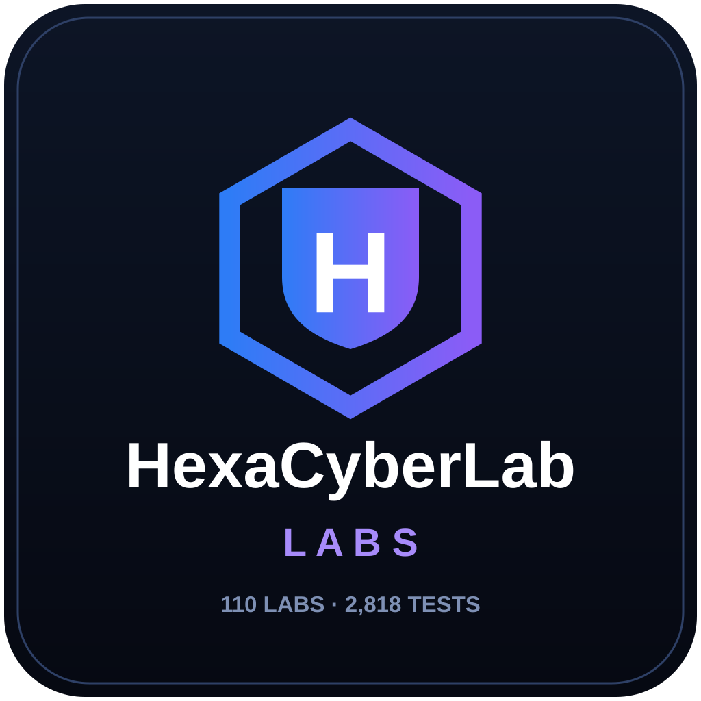

<p align="center">
  
</p>

# HexaCyberLab Practice Labs — The Complete 110-Lab Programme

    

**110 deliberately vulnerable business applications. 2,818 scored security tests. One unlock chain.**

Built by **Md. Jony Hassain**, Founder of [HexaCyberLab](https://hexacyberlab.great-site.net/), as a complete hands-on training ground for web penetration testing — every lab is a full, working business application with its own realistic workflows, and its own unique set of vulnerabilities derived from how that business actually operates.

> ⚠️ **SAFETY — READ FIRST**
> Every application in this repository is **intentionally vulnerable**. Run them **locally only**. Never deploy any lab to a public server, never expose a lab port to the internet, and never enter real credentials or real personal data. All seed data is fake. These labs exist so you can practise legally, on your own machine.

---

## Showcase

All 110 labs, unlocked and running — one screenshot per lab:


*Open it full-size from the [v1.0.0 release](https://github.com/jonyhossan110/hexacyberlab-labs/releases/tag/v1.0.0), where the complete programme ZIP also lives.*

## How the programme works

- **Numbered, sequential labs.** Lab 1 → Lab 110, across 11 categories. Lab 1 is open. Every later lab is locked by a **completion key**: finish a lab at 100% and it reveals the key that unlocks the next one. Lab 110's completion earns the final **Grandmaster** key.
- **Progress is scored per test.** Each lab tracks your progress against its own full test list (features × every vulnerability/technique that applies to them). Exploits are detected **server-side, by their real effect** — there are no checkboxes. Do the exploit, the score moves.
- **Progress survives restarts.** Close a lab at 40% and reopen it later — you resume at 40%.
- **Hints beside every test**, in three graded levels.
- **A Lab Coach (chatbot) inside every lab.** It knows each feature's vulnerabilities and how to test them — but it only helps with a feature **after you have genuinely tried it at least 3 times**. Before that, it tells you to try first. It never reveals the completion key before 100%.
- **At 100%:** a completion summary (what you tested, what you learned, how each finding translates into real client damage prevented, and how to write it up in a professional report) plus a **certificate** with the HexaCyberLab logo.
- **Fix & Retest:** every lab ships with a `FIX-AND-RETEST.md` — apply the fixes, re-run the attacks, and confirm each one now fails.

## ⬢ New in v2.0 — the Hexa Gateway

One command now runs the whole programme, and every lab gained a set of professional tools. Start it from the project root:

- **Windows:** `start.ps1`
- **Linux / macOS / Kali:** `./start.sh`
- **Anywhere:** `node gateway/server.js`

Then open **http://localhost:4000** — the Gateway dashboard.

1. **🎛 Launcher Dashboard** — all 110 labs in one place: status, port and live progress for each, with Start / Stop / Open. Each lab lives on its own port, so switching labs is like switching websites: change the port in the URL, you are in a different lab.
2. **📟 Live Server Console** — every lab started through the Gateway logs like a real production server: each request as it arrives, what the server accepted and sent back, and a ★ announcement the moment a test passes. Watch it in the dashboard console or in the terminal window you launched from — this is how you learn what the server actually does when you attack it.
3. **🐛 Payload Debugger** — inside every lab (toolbar, bottom-left) and at `/hexa/debugger`: paste a payload that failed and it tells you *why* — "your quote breaks here", "this filter ate your tag", "try another encoding". It also captures your recent attempts in that lab automatically. Not the answer — the diagnosis. This is what turns beginners into intermediates.
4. **📖 Real-World Case Studies** — inside every lab at `/hexa/case-study`, and collected in [`case-studies/`](case-studies/CASE-STUDIES.md): for each vulnerability class, the real company it happened to, the year, what it cost them, and the source. The lab stops being a game and becomes the real world.
5. **💼 Unlockable Business Skills** — finishing a category at 100% now unlocks a business lesson in the dashboard: what you are selling, scope documents, pricing an audit, talking to clients, proposals & authorization, running the engagement, writing the report, Fix & Retest delivery, getting paid, retainers, and building your brand. The programme is no longer just a place to learn — it is a career ladder. See [`business-skills/`](business-skills/README.md).
6. **🖥 Kali Terminal** — from the dashboard or any lab's toolbar: a real shell on your own machine in a new browser tab (on Windows, your WSL distros — including Kali — appear automatically). Test the labs the Kali way: `curl`, `nmap`, `sqlmap`, `whatweb` against `http://localhost:<port>`. Plus the full [**Burp Suite Guide**](BURP-SUITE-GUIDE.md): every lab also documents its Burp workflow (Proxy → Repeater → Intruder) in its own README.

> The Gateway binds to **127.0.0.1 only** — it can start programs on your machine, so never expose port 4000 (or any lab port) to a network.

## How this differs from other vulnerable-app projects

Most well-known training projects put many vulnerabilities inside **one** application. This programme spreads them across **110 complete business applications**, all connected by a single progression system.

| Project | Applications | Scoring | Progression system |
|---|---|---|---|
| OWASP Juice Shop | 1 (one e-commerce app) | Challenge tracking inside the app | — |
| OWASP WebGoat | 1 (lesson-based) | Lessons & assignments | — |
| DVWA · bWAPP · Mutillidae | 1 each | Mostly unscored practice pages | — |
| vulhub | Many Docker environments (real-software CVE reproductions) | None — no curriculum | — |
| **HexaCyberLab Labs** | **110 complete business apps** | **2,818 server-detected tests** | **Sequential key-unlock chain · saved progress · in-lab coach · certificates · Fix & Retest** |

## Repository structure

The 110 labs are organised into **11 category folders**, 10 labs in each:

| Folder | Category | Labs |
|---|---|---|
| `01-ecommerce-retail/` | E-commerce & Retail | 1–10 |
| `02-saas-business/` | SaaS & Business Platforms | 11–20 |
| `03-api-developer/` | API & Developer Platforms | 21–30 |
| `04-ai-intelligent-apps/` | AI & Intelligent Applications | 31–40 |
| `05-finance-payments-insurance/` | Finance, Payments & Insurance | 41–50 |
| `06-education/` | Education & E-learning | 51–60 |
| `07-healthcare/` | Healthcare & Wellness | 61–70 |
| `08-travel-hospitality-transport/` | Travel, Hospitality & Transport | 71–80 |
| `09-media-social-community/` | Media, Social & Community | 81–90 |
| `10-property-jobs-services/` | Property, Jobs & Professional Services | 91–100 |
| `11-specialized-advanced/` | Specialized & Advanced Business Systems | 101–110 |

## Running a lab

Each lab is a zero-dependency Node.js application in its own folder, inside its category folder.

```bash
cd 01-ecommerce-retail/hexashop
node server.js
# then open http://127.0.0.1:3000
```

Or with Docker:

```bash
cd 01-ecommerce-retail/hexashop
docker compose up
```

Requirements: Node.js 20+ (Lab 1, HexaShop, needs Node.js 22+). Labs bind to `127.0.0.1` only.

Per-lab documentation: `README.md` (setup + test accounts), `VULNERABILITIES.md` (every scored test, by feature), `PRACTICE-GUIDE.md` (challenges with hints and objectives), `FIX-AND-RETEST.md`.

---

## Category 1 — E-commerce & Retail (Labs 1–10) · 238 tests

| Lab | Name | Port | Tests | Business |
|----:|------|-----:|------:|----------|
| 1 | HexaShop | 3000 | 25 | Online store — products, cart, checkout, orders |
| 2 | HexaFashion | 3010 | 24 | Fashion retail store |
| 3 | HexaElectro | 3011 | 27 | Electronics store |
| 4 | HexaMart | 3012 | 23 | General marketplace store |
| 5 | HexaLuxury | 3013 | 23 | Luxury goods boutique |
| 6 | HexaGrocery | 3014 | 22 | Online grocery |
| 7 | HexaCraft | 3015 | 22 | Handmade crafts marketplace |
| 8 | HexaAutoParts | 3016 | 22 | Auto parts store |
| 9 | HexaBookStore | 3017 | 26 | Bookstore |
| 10 | HexaWholesale | 3018 | 24 | B2B wholesale portal |

## Category 2 — SaaS & Business Platforms (Labs 11–20) · 254 tests

| Lab | Name | Port | Tests | Business |
|----:|------|-----:|------:|----------|
| 11 | HexaSaaS | 3020 | 26 | Multi-tenant SaaS platform |
| 12 | HexaCRM | 3021 | 26 | Customer relationship manager |
| 13 | HexaProject | 3022 | 27 | Project management |
| 14 | HexaHR | 3023 | 24 | HR & employee management |
| 15 | HexaInvoice | 3024 | 26 | Invoicing & billing |
| 16 | HexaAnalytics | 3025 | 25 | Analytics dashboard |
| 17 | HexaWorkspace | 3026 | 25 | Team workspace |
| 18 | HexaSupport | 3027 | 25 | Support ticketing |
| 19 | HexaBooking | 3028 | 26 | Booking & reservations |
| 20 | HexaForms | 3029 | 24 | Form builder |

## Category 3 — API & Developer Platforms (Labs 21–30) · 255 tests

| Lab | Name | Port | Tests | Business |
|----:|------|-----:|------:|----------|
| 21 | HexaAPI | 3030 | 25 | REST API platform |
| 22 | HexaDevHub | 3031 | 25 | Developer portal |
| 23 | HexaCloud | 3032 | 26 | Cloud resource manager |
| 24 | HexaDeploy | 3033 | 26 | Deployment pipeline |
| 25 | HexaGit | 3034 | 26 | Code hosting |
| 26 | HexaWebhook | 3035 | 26 | Webhook service |
| 27 | HexaMonitor | 3036 | 26 | Uptime monitoring |
| 28 | HexaDataHub | 3037 | 26 | Data sharing hub |
| 29 | HexaAuth | 3038 | 24 | Authentication service |
| 30 | HexaPackage | 3039 | 25 | Package registry |

## Category 4 — AI & Intelligent Applications (Labs 31–40) · 256 tests

| Lab | Name | Port | Tests | Business |
|----:|------|-----:|------:|----------|
| 31 | HexaAI | 3040 | 26 | AI chat platform (simulated) |
| 32 | HexaWriter | 3041 | 26 | AI writing assistant (simulated) |
| 33 | HexaVision | 3042 | 26 | Image AI service (simulated) |
| 34 | HexaResearch | 3043 | 25 | AI research assistant (simulated) |
| 35 | HexaAgent | 3044 | 26 | AI agent platform (simulated) |
| 36 | HexaRAG | 3045 | 25 | RAG knowledge base (simulated) |
| 37 | HexaVoice | 3046 | 26 | Voice AI service (simulated) |
| 38 | HexaTranslate | 3047 | 25 | Translation service (simulated) |
| 39 | HexaCodeAI | 3048 | 25 | AI code assistant (simulated) |
| 40 | HexaModelHub | 3049 | 26 | Model marketplace (simulated) |

## Category 5 — Finance, Payments & Insurance (Labs 41–50) · 255 tests

| Lab | Name | Port | Tests | Business |
|----:|------|-----:|------:|----------|
| 41 | HexaPay | 3050 | 26 | Payment service |
| 42 | HexaWallet | 3051 | 25 | Digital wallet |
| 43 | HexaBank | 3052 | 26 | Online banking |
| 44 | HexaFintech | 3053 | 26 | Fintech platform |
| 45 | HexaInvest | 3054 | 25 | Investment platform |
| 46 | HexaLoan | 3055 | 25 | Loan service |
| 47 | HexaInsurance | 3056 | 25 | Insurance portal |
| 48 | HexaBilling | 3057 | 26 | Subscription billing |
| 49 | HexaTax | 3058 | 25 | Tax filing service |
| 50 | HexaExpense | 3059 | 26 | Expense management |

## Category 6 — Education & E-learning (Labs 51–60) · 260 tests

| Lab | Name | Port | Tests | Business |
|----:|------|-----:|------:|----------|
| 51 | HexaLearn | 3060 | 26 | E-learning platform |
| 52 | HexaAcademy | 3061 | 26 | Online academy |
| 53 | HexaExam | 3062 | 26 | Online exams |
| 54 | HexaTutor | 3063 | 26 | Tutoring marketplace |
| 55 | HexaCampus | 3064 | 26 | Campus management |
| 56 | HexaLibrary | 3065 | 26 | Digital library |
| 57 | HexaKids | 3066 | 26 | Kids learning app (fake data only) |
| 58 | HexaSkill | 3067 | 26 | Skills courses |
| 59 | HexaCert | 3068 | 26 | Certification service |
| 60 | HexaResearchLab | 3069 | 26 | Research publications |

## Category 7 — Healthcare & Wellness (Labs 61–70) · 260 tests

| Lab | Name | Port | Tests | Business |
|----:|------|-----:|------:|----------|
| 61 | HexaClinic | 3070 | 26 | Clinic management |
| 62 | HexaCare | 3071 | 26 | Care services |
| 63 | HexaPharma | 3072 | 26 | Pharmacy |
| 64 | HexaLabTest | 3073 | 26 | Lab test booking & reports |
| 65 | HexaDental | 3074 | 26 | Dental practice |
| 66 | HexaTelemed | 3075 | 26 | Telemedicine |
| 67 | HexaFitness | 3076 | 26 | Fitness platform |
| 68 | HexaNutrition | 3077 | 26 | Nutrition coaching |
| 69 | HexaMentalWell | 3078 | 26 | Mental wellness journal (fake data only) |
| 70 | HexaHealthInsure | 3079 | 26 | Health insurance |

## Category 8 — Travel, Hospitality & Transport (Labs 71–80) · 260 tests

| Lab | Name | Port | Tests | Business |
|----:|------|-----:|------:|----------|
| 71 | HexaTravel | 3080 | 26 | Travel booking |
| 72 | HexaHotel | 3081 | 26 | Hotel booking |
| 73 | HexaFlight | 3082 | 26 | Flight booking |
| 74 | HexaRide | 3083 | 26 | Ride hailing |
| 75 | HexaFleet | 3084 | 26 | Fleet management |
| 76 | HexaShip | 3085 | 26 | Shipping & logistics |
| 77 | HexaCourier | 3086 | 26 | Courier service |
| 78 | HexaRent | 3087 | 26 | Car rental |
| 79 | HexaEventTrip | 3088 | 26 | Event travel |
| 80 | HexaRestaurant | 3089 | 26 | Restaurant reservations & orders |

## Category 9 — Media, Social & Community (Labs 81–90) · 260 tests

| Lab | Name | Port | Tests | Business |
|----:|------|-----:|------:|----------|
| 81 | HexaSocial | 3090 | 26 | Social network |
| 82 | HexaForum | 3091 | 26 | Discussion forum |
| 83 | HexaMedia | 3092 | 26 | Media gallery |
| 84 | HexaStream | 3093 | 26 | Video streaming (simulated) |
| 85 | HexaPodcast | 3094 | 26 | Podcast platform (simulated) |
| 86 | HexaMusic | 3095 | 26 | Music streaming (simulated) |
| 87 | HexaCreator | 3096 | 26 | Creator platform |
| 88 | HexaNewsletter | 3097 | 26 | Newsletter service (sending simulated) |
| 89 | HexaChat | 3098 | 26 | Team chat |
| 90 | HexaCommunity | 3099 | 26 | Community platform |

## Category 10 — Property, Jobs & Professional Services (Labs 91–100) · 260 tests

| Lab | Name | Port | Tests | Business |
|----:|------|-----:|------:|----------|
| 91 | HexaProperty | 3100 | 26 | Property listings |
| 92 | HexaRentals | 3101 | 26 | Rental management |
| 93 | HexaJobs | 3102 | 26 | Job board |
| 94 | HexaHire | 3103 | 26 | Recruitment SaaS |
| 95 | HexaFreelance | 3104 | 26 | Freelance marketplace |
| 96 | HexaAgency | 3105 | 26 | Agency client portal |
| 97 | HexaLegal | 3106 | 26 | Legal case portal |
| 98 | HexaConsult | 3107 | 26 | Consulting deliverables |
| 99 | HexaAuction | 3108 | 26 | Online auctions |
| 100 | HexaDirectory | 3109 | 26 | Business directory |

## Category 11 — Specialized & Advanced Business Systems (Labs 101–110) · 260 tests

| Lab | Name | Port | Tests | Business |
|----:|------|-----:|------:|----------|
| 101 | HexaIoT | 3110 | 26 | IoT device platform (simulated devices) |
| 102 | HexaSmartHome | 3111 | 26 | Smart-home simulator |
| 103 | HexaSupply | 3112 | 26 | Supply chain management |
| 104 | HexaManufacture | 3113 | 26 | Manufacturing ERP |
| 105 | HexaAgri | 3114 | 26 | Agriculture management |
| 106 | HexaEnergy | 3115 | 26 | Energy utility & billing |
| 107 | HexaInsuranceClaim | 3116 | 26 | Insurance claims processing |
| 108 | HexaIdentity | 3117 | 26 | Digital identity portal (fake data only) |
| 109 | HexaWorkflow | 3118 | 26 | Workflow automation |
| 110 | HexaIncident | 3119 | 26 | Incident management — final lab |

**Total: 110 labs · 2,818 scored tests.**

---

## What you will practise

Broken access control & IDOR, SQL injection, XSS (stored/reflected), CSRF, authentication weaknesses (brute force, enumeration, predictable reset tokens, weak/default credentials), session & cookie tampering, mass assignment, business-logic flaws (price/quantity/approval manipulation), file upload & path traversal, insecure API design, information disclosure, and more — always inside a realistic business workflow, mapped to OWASP categories, with a Fix & Retest path for every finding.

## License

MIT — © Md. Jony Hassain / HexaCyberLab. See `LICENSE`.

## About

HexaCyberLab provides web penetration testing and security audits for SaaS, startups and e-commerce businesses. These labs are the training ground behind that work — proof over promises.

*Local use only. Practise legally. Never point these applications — or the techniques you learn — at systems you do not own or have explicit permission to test.*
